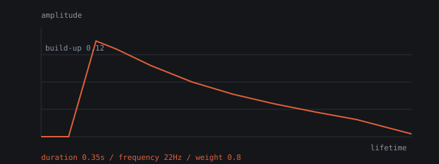

# game-camera-shake

Curve-driven camera shake for Unity, built around authored profiles instead of
one-off `Random.insideUnitSphere` calls. Each profile carries its own envelope
curve, frequency, translation and rotation budgets, so a landing thud and a
short muzzle kick feel different without new code paths.

Shakes are additive layers summed in `LateUpdate`. Layers hold independent
clocks, which keeps overlapping hits from phase-locking into a single wobble.
The driver only ever writes `localPosition`/`localRotation`, so a follow camera
can keep driving the parent.



## Why

Most shake snippets are fire-and-forget coroutines with fixed numbers baked in.
They are fine for a jam, painful when a designer wants a softer landing or a
weightier explosion. Here the *shape* of the shake is an asset: retune the curve,
duplicate the profile, compare in play mode. Nothing in the runtime needs to
change.

## Install

Copy the `Runtime/` folder into your project's `Assets/`, or add it as a local
package reference. The runtime is engine-only and has no third-party
dependencies; the assembly definition is named `Wobble.Shake`.

```
Assets/Wobble/Shake/Runtime/   <- copy here
```

Tested with Unity 2022.3 LTS and newer. Requires .NET Standard 2.1.

## Usage

1. Add `CameraShake` to the camera GameObject.
2. Create a profile: `Assets > Create > Camera Shake > Profile`.
3. Author the envelope (loud at the start, decaying to zero) and budgets.
4. Trigger it from gameplay code:

```csharp
using Wobble.Shake;
using UnityEngine;

public sealed class Landing : MonoBehaviour
{
    [SerializeField] private CameraShake shake;
    [SerializeField] private ShakeProfile landProfile;

    public void OnGrounded(float fallSpeed)
    {
        shake.Add(landProfile, Mathf.Clamp01(fallSpeed / 12f));
    }
}
```

`Add(profile, scale)` multiplies the whole profile by `scale`, which is handy for
distance- or speed-based intensity. `StopAll()` clears the stack;
`RecaptureRest()` re-bases the neutral pose after teleports.

### Mixing and falloff

The component's `mode` picks how simultaneous layers combine: `Additive` (default)
stacks impacts, `Strongest` lets the loudest layer win so directions stay readable,
and `WeightedAverage` softens crowds of near-equal shakes into one push.

For spatial sources use `AddAt(profile, worldPosition)` with a `FalloffVolume` on
the explosion or hazard. Strength is full inside `innerRadius` and fades to silence
at `radius`; nothing happens outside every volume.

## Controls (demo scene)

- `Space` — play the selected profile at full strength
- `1` / `2` / `3` — switch between light, medium and heavy profiles
- `Esc` — `StopAll()`

## Layout

```
Runtime/
  CameraShake.cs     layer stack, mixing, LateUpdate summation, neutral pose
  ShakeLayer.cs      per-instance clock, envelope sampling, noise
  ShakeProfile.cs    ScriptableObject: curves, budgets, weight
  Blending/          additive, strongest and weighted-average mixers
  Falloff/           distance attenuation volume for world-space sources
  Wobble.Shake.asmdef
```

## Build steps

1. Open the project in Unity 2022.3 LTS or newer.
2. Import the demo scene, enter play mode, press `Space`.
3. For a player build: `File > Build Settings`, add the demo scene, target
   desktop, build.

## Notes

- Shake is local-space; on a camera parented to a rig, bias the profiles toward
  rotation so translation does not slide the view through walls.
- `maxLayers` is a hard budget. Anything beyond it evicts the oldest layer, so
  bursty effects degrade instead of stacking forever.

## License

MIT, see [LICENSE](LICENSE).
